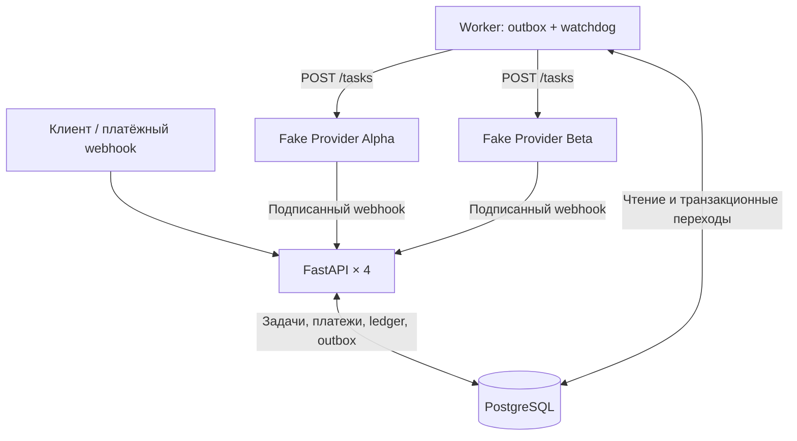

# Integer — Generation Service

Асинхронный сервис генерации на **Python 3.12 / FastAPI / PostgreSQL / SQLAlchemy**.
Принимает оплату токенами, создаёт задачи, отправляет их провайдерам Alpha/Beta,
обрабатывает webhook-результаты, выполняет failover и возвращает токены при ошибках.
Рассчитан на **4 API-процесса** и отдельный фоновый worker; состояние хранится в PostgreSQL.

## Архитектура



Платёж и списание токенов фиксируются **до внешнего HTTP-запроса**.
Worker отправляет сохранённое в outbox событие провайдеру; webhook или watchdog
завершает попытку, переводит задачу на следующую ногу либо делает однократный возврат.

## Быстрый старт

Нужны **Docker Desktop / Docker Compose** и свободные локальные порты `8000` (API)
и `55432` (PostgreSQL). Все команды ниже рассчитаны на **PowerShell** из корня проекта.

```powershell
Copy-Item .env.example .env
docker compose up --build -d
```

- Swagger UI: http://localhost:8000/docs
- Проверка работоспособности: http://localhost:8000/health
- PostgreSQL и Alembic запускаются автоматически; отдельную регистрацию пользователя делать не нужно.

### Пример: оплата → генерация → статус → баланс

Этот PowerShell-пример использует **только локальный секрет** из `.env.example`.
Если поменяли `PAYMENT_WEBHOOK_SECRET` в `.env`, укажите его же в `$secret`.

```powershell
$base = "http://localhost:8000"
$secret = "dev-payment-secret"
$userId = [guid]::NewGuid().ToString()

# 1. Формируем JSON и подписываем именно его исходные UTF-8 байты.
$paymentJson = @{
    payment_id = [guid]::NewGuid().ToString()
    user_id    = $userId
    tokens     = 10
    status     = "completed"
} | ConvertTo-Json -Compress
$body = [System.Text.Encoding]::UTF8.GetBytes($paymentJson)
$hmac = [System.Security.Cryptography.HMACSHA256]::new(
    [System.Text.Encoding]::UTF8.GetBytes($secret)
)
$signature = ([BitConverter]::ToString($hmac.ComputeHash($body))).Replace("-", "").ToLowerInvariant()
$hmac.Dispose()

Invoke-RestMethod -Method Post -Uri "$base/webhooks/payments" `
    -Body $body -ContentType "application/json" -Headers @{ "X-Signature" = $signature }

# 2. Создаём задачу (цена image-fast — 2 токена).
$requestJson = @{
    user_id    = $userId
    model_slug = "image-fast"
    prompt     = "A cat on the moon"
    ref_images = @()
} | ConvertTo-Json -Compress
$created = Invoke-RestMethod -Method Post -Uri "$base/generate" `
    -Body $requestJson -ContentType "application/json"

# 3. Ожидаем результат фоновой обработки.
for ($i = 0; $i -lt 30; $i++) {
    $task = Invoke-RestMethod -Uri "$base/tasks/$($created.task_id)"
    if ($task.status -notin @("pending", "processing")) { break }
    Start-Sleep -Seconds 1
}

# 4. Проверяем остаток и последние проводки.
$balance = Invoke-RestMethod -Uri "$base/users/$userId/balance"
[pscustomobject]@{
    TaskId  = $created.task_id
    Status  = $task.status
    Balance = $balance.balance
}
```

При стандартном режиме провайдера `success` ожидаем статус `completed` и баланс
**8 токенов** (`10 − 2`). Результат асинхронный: сразу после `POST /generate`
статус может быть `pending` или `processing`.

## API и маршрутизация
Пользователь создаётся первым успешным платежным вебхуком: отдельного
endpoint регистрации по заданию нет. Для запросов к вебхукам требуется
`X-Signature`: hex HMAC-SHA256 **оригинальных байтов JSON** с общим секретом.
Значения секретов для локальной разработки приведены в `.env.example`.

### Эндпоинты

| Метод | Путь | Назначение |
| --- | --- | --- |
| POST | `/webhooks/payments` | Подписанная оплата: `payment_id, user_id, tokens, status` |
| POST | `/generate` | `user_id, model_slug, prompt, ref_images`; возвращает 202 и `task_id` |
| POST | `/webhooks/providers/{name}` | Подписанный результат Alpha/Beta |
| GET | `/tasks/{task_id}` | Текущий статус, провайдер и история попыток |
| GET | `/users/{user_id}/balance` | Баланс и 20 последних проводок |
| GET | `/health` | Healthcheck |

Неизвестная модель или отсутствие подходящих ног: HTTP 400 до списания.
Недостаточно токенов: 402. Уже три активные генерации: 429.
Некорректная подпись вебхука: 401.

### Модели и правила failover

| Модель | Цена | Ноги по приоритету |
| --- | ---: | --- |
| `image-fast` | 2 | alpha (до 4 референсов) → beta (до 10) |
| `video-long` | 25 | beta (до 2) → alpha (до 1, `skip_on_moderation`) |

Нога подходит, если `len(ref_images) <= max_ref_images`. Ошибка `technical`,
HTTP 5xx или сетевой таймаут переключает на следующую совместимую ногу.
После `moderation` пропускаются последующие ноги с
`skip_on_moderation=True`. Ошибка `payload` завершает задачу немедленно.
Если ног больше нет, задача переходит в `failed` с возвратом средств.

## Транзакционные гарантии и конкурентность

**Платёж.** Одна транзакция PostgreSQL создаёт пользователя (если нужно),
блокирует его строку `SELECT FOR UPDATE`, вставляет платёж с уникальным
`payment_id`, а для победившей вставки увеличивает баланс и записывает
`ledger_entries`. Повторный платёж с теми же реквизитами не начисляется снова.
Повторное использование ID с другой суммой или пользователем даёт 409.
Нефинальные статусы платежа игнорируются до получения успешного статуса.
При начислении резервируется вместимость BIGINT под все возможные возвраты
активных генераций; credit, нарушающий этот предел, получает HTTP 409.

**Генерация.** Проверка лимита активных задач, списание, создание задачи,
первой попытки и события `outbox_events` выполняются внутри одной транзакции
после блокировки пользователя. Конкурентные запросы к одному пользователю
не могут обойти лимит задач или дважды потратить одни и те же токены.

**Failover и возврат.** Обработчик результата блокирует строки в порядке
«пользователь → задача → попытка», проверяет идентификатор текущей попытки
и её состояние. В случае исчерпания ног финальный статус `failed`,
возврат денег и проводка с уникальным ключом `refund:{task_id}`
фиксируются одной транзакцией. Дубликаты и проигравшие гонку вебхуки
игнорируются; сумма баланса равна сумме всех проводок пользователя.

**Падение процесса во время вебхука.** Если процесс падает до commit, PostgreSQL
откатывает и статус, и изменение баланса, и проводку. Если падение происходит
после commit, повторный вебхук видит уже завершённую попытку/платёж и
не выполняет повторное начисление или возврат.

**Поздний completed.** Если watchdog уже перевёл попытку на следующую ногу
или завершил задачу с возвратом, опоздавший результат игнорируется.
Если успешный вебхук получает блокировку и фиксирует результат первым,
watchdog не отменяет успех задним числом. Одновременно получить
`completed` и возврат невозможно при корректной обработке через PostgreSQL.

**Outbox.** Результаты синхронных HTTP-вызовов применяются только при
действительном lease события; timeout старого worker не может отменить
подтверждённый HTTP 202 нового владельца.
Диспетчер использует `FOR UPDATE SKIP LOCKED`, аренду
(`claimed_until`), время повторной попытки и проверку владения lease
при подтверждении. Внешняя отправка происходит *после* коммита
финансовой транзакции. Внутренний `attempt_id` служит постоянным ключом идемпотентности,
а `external_id` возвращается провайдером и сохраняется для сопоставления webhook.
Ранний подписанный webhook может установить внешний ID до HTTP-ответа.
Повторная отправка может произойти при сетевой
неопределённости или падении worker; идентификатор попытки постоянный.
Фейковые провайдеры обеспечивают идемпотентность повторного `POST /tasks`
в пределах жизни процесса, но их память не сохраняется после рестарта.
Строгое «ровно один раз» для удалённого выполнения через HTTP не заявляется.

**Согласованность чтений.** `GET /tasks/{task_id}` формирует статус, текущую ногу
и историю попыток из одной `REPEATABLE READ` транзакции. Аналогично
`GET /users/{user_id}/balance` читает баланс и журнал из одного снимка БД.

**Watchdog.** Попытки `sending`/`waiting` с истёкшим `deadline_at`
обрабатываются теми же транзакционными переходами, что и ошибки вебхука.
`PROVIDER_TIMEOUT` по умолчанию 60 секунд;
`WATCHDOG_INTERVAL_SECONDS` — 2 секунды.
Повторная доставка outbox не продлевает уже установленный deadline.

### Фейковые провайдеры

POST `/tasks` отвечает 202 с `external_id` и позднее отправляет
подписанный `completed`/ `failed`.
Поддерживаются настройки окружения `FAKE_PROVIDER_MODE`,
`FAKE_PROVIDER_DELAY`, `FAKE_PROVIDER_FAILURE_RATE`,
`FAKE_PROVIDER_FAILURE_TYPE`.
Режимы: `success`, `technical`, `moderation`, `payload`,
`duplicate`, `no_webhook`, `late_success`, `http_500`, `http_503`,
`http_400`, `http_403`, `timeout`, `random`.
Стандартная задержка фейкового провайдера — 2 секунды.
`/_test/config` и `/_test/jobs/{attempt_id}` разрешены только при
`FAKE_PROVIDER_TEST_CONTROL=1` в отдельном E2E-контуре.

## Миграции

При `docker compose up` служба `migrate` автоматически применяет `alembic upgrade head`
до запуска API и worker. Миграция `0001_initial.py` создаёт таблицы и каталог моделей;
`0002_audit_schema.py` корректирует sequences после seed и выравнивает `NOT NULL`
у временных меток с ORM. Уже применённую начальную миграцию не редактируем.

Текущая версия схемы и соответствие ORM (после старта контейнеров):

```powershell
docker compose exec api alembic current
docker compose exec api alembic check
```

Для следующего изменения: создать новую ревизию `alembic revision -m "description"`
из локального окружения разработки, заполнить `upgrade()` / `downgrade()` и применить
`alembic upgrade head`. Существующие данные не требуют повторного seed.
## Тесты и статический анализ

Интеграционные тесты выполняются на **отдельной PostgreSQL `test-db`**,
не затрагивая базу основного сервиса:

```powershell
docker compose run --build --rm tests
```

Для Ruff и Pyright нужен Python **3.12+** в `PATH`; локальное окружение можно
создать с нуля (пример для Windows):

```powershell
python -m venv .venv
.\.venv\Scripts\python.exe -m pip install -e ".[dev]"
.\.venv\Scripts\python.exe -m ruff check .
.\.venv\Scripts\python.exe -m ruff format --check .
.\.venv\Scripts\python.exe -m pyright
```

Альтернатива без локального Python — проверки в Docker test image:

```powershell
docker compose run --build --no-deps --rm tests python -m ruff check .
docker compose run --no-deps --rm tests python -m ruff format --check .
docker compose run --no-deps --rm tests python -m pyright
```

Проверяются конкурентные платежи и списания, ограничение активных задач,
двойные callback, failover, возвраты, гонки watchdog/worker/lease, пограничные
значения баланса, целостность снимков API и нестандартные ответы провайдеров.
## Сетевой E2E

E2E проверяет настоящие HTTP-вызовы между контейнерами: **4 API-процесса**,
два worker, Alpha/Beta и PostgreSQL. Для скрипта нужен локальный Python 3.12+
и зависимости `.[dev]` (см. раздел выше).

**Важно:** тест рассчитан на пустую базу. Перед повторным запуском удаляем
контейнеры **только отдельного Compose-проекта `integer-e2e`**.
Тестовая БД хранится в `tmpfs` и пересоздаётся без влияния на основной сервис.

```powershell
docker compose -f compose.e2e.yaml -p integer-e2e down
docker compose -f compose.e2e.yaml -p integer-e2e up --build -d
.\.venv\Scripts\python.exe tests/e2e_live.py
docker compose -f compose.e2e.yaml -p integer-e2e down
```

Используемые локальные порты: `18000` (API), `18101` (Alpha), `18102` (Beta).
Сценарий проверяет 20 конкурентных одинаковых платежей, success/failover/timeout,
сохранение outbox при остановке worker, параллельных worker и повторные callback.
Контрольный конечный баланс — **88 токенов**, без двойных списаний и возвратов.
## Известные ограничения

- Фейковые провайдеры хранят заявки в памяти процесса; при перезапуске
  callback может потеряться, после чего watchdog переведёт задачу по таймауту.
- Внешний HTTP использует семантику **at-least-once**: после сетевой
  неопределённости возможен повторный POST. Идемпотентность фейковых
  провайдеров действует только в пределах жизни их процесса.
- E2E проверяет восстановление ожидающего outbox-события при перезапуске
  worker, но не все возможные точки падения во время HTTP.
- Тесты подтверждают проверенные сценарии и инварианты, а не абсолютное
  отсутствие редких конкурентных ошибок.
